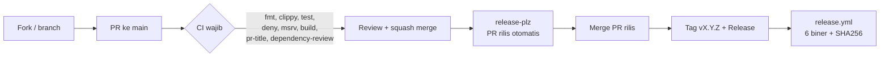

# Sistem GitHub — kontribusi, CI/CD, versioning, rilis

Dokumen ini adalah runbook lengkap untuk alur open-source `maicli`:
**PR → gerbang CI wajib → review → squash merge → PR rilis otomatis →
tag `vX.Y.Z` → 6 biner + checksum di GitHub Release.**

## Alur



## 0. Nama repo

Rekomendasi nama + cek ketersediaan ada di `docs/nama-publik.md`. Ringkas:
repo `ModelUXAI/maicli`, paket npm `@modeluxai/cli`, biner tetap `maicli`.

## 1. Setup sekali jalan

1. Buat repo GitHub **kosong** (tanpa README): `ModelUXAI/maicli` (atau ganti `REPO`).
2. Push `main` dan tag awal:
   ```bash
   git remote add origin git@github.com:ModelUXAI/maicli.git
   git push -u origin main
   git push origin v0.1.0   # wajib: baseline release-plz (tag sudah ada lokal)
   ```
3. Jalankan konfigurasi repo (butuh `gh auth login` + admin):
   ```bash
   REPO=ModelUXAI/maicli ./scripts/setup-github.sh
   ```
   Script memasang:
   - squash-only merge, auto-merge, hapus branch setelah merge;
   - ruleset `main-protection`: PR wajib, 1 review, **review CODEOWNERS**, thread resolved,
     linear history, no force-push/delete, checks wajib;
   - default `GITHUB_TOKEN` read + izin membuat PR (release-plz);
   - vulnerability alerts/Dependabot/private reporting (best effort);
   - label `feat`, `fix`, `docs`, `security`, `dependencies`, dll.
4. UI GitHub → **Settings → Code security**: aktifkan **Secret scanning** +
   **Push protection** (repo publik), dan **Private vulnerability reporting**.
5. **Settings → Actions → General**: pastikan *Allow GitHub Actions to create and
   approve pull requests* aktif (script mencoba menyalakan).
6. Opsional: **Settings → Environments → `release`** + required reviewer, lalu
   tambahkan `environment: release` ke job release bila rilis harus disetujui manual.
7. Opsional npm: isi secret `NPM_TOKEN`; workflow `npm-publish.yml` hanya berjalan
   manual (`workflow_dispatch`).

## 2. Gerbang wajib (required checks)

| Check | Isi | Platform |
|---|---|---|
| `fmt` | `cargo fmt --all -- --check` | Linux |
| `clippy (ubuntu-latest)` | clippy `-D warnings` seluruh workspace | Linux |
| `clippy (windows-latest)` | sama, kode `cfg(windows)` ikut dilint | Windows |
| `test (ubuntu-latest)` | `cargo test --workspace --locked` (546+ test + 9 E2E) | Linux |
| `test (windows-latest)` | sama | Windows |
| `test (macos-latest)` | sama; **allow-failure** sampai verifikasi macOS | macOS |
| `build-release` | `cargo build --release -p tui-app` | Linux |
| `deny` | `cargo deny check` (advisory/license/ban/source) | Linux |
| `msrv` | `cargo +1.89.0 check --workspace --all-targets` (menimpa toolchain stable) | Linux |
| `actionlint` | validasi sintaks/ekspresi semua workflow | Linux |
| `pr-title` | judul PR = Conventional Commits | PR saja |
| `dependency-review` | tolak dependency baru severity high | PR saja |

`bash check.sh` lokal memakai `RUST_TEST_THREADS=1` secara default (bisa ditimpa
`RUST_TEST_THREADS=8 bash check.sh`) karena E2E relay/subagent sensitif terhadap
beban paralel. CI dan release memakai setelan serial yang sama.

Ruleset mensyaratkan **branch up to date** (`strict_required_status_checks_policy`),
jadi PR harus rebase/merge `main` sebelum merge bila `main` bergerak.
Admin punya bypass **hanya untuk aturan PR** (bisa merge PR sendiri tanpa review);
required status checks tetap wajib. Untuk darurat total, nonaktifkan ruleset
sementara dan catat alasannya di PR/issue.

## 3. Alur kontributor

1. Fork repo; branch dari `main`: `feat/...`, `fix/...`, `docs/...`, `perf/...`,
   `refactor/...`, `test/...`, `ci/...`, `chore/...`.
2. Commit dengan **Conventional Commits**:
   - `feat(scope): ...` → MINOR
   - `fix(scope): ...` → PATCH
   - `feat!:` / `BREAKING CHANGE:` → MAJOR (untuk `0.x`: MINOR)
   - `docs|refactor|perf|test|build|ci|chore`: tanpa bump kecuali digabung
3. Jalankan gerbang lokal: `bash check.sh` (Linux/macOS) atau `.\check.ps1`.
4. Buka PR; judul PR juga harus Conventional (dipakai squash merge).
5. Tunggu required checks hijau + 1 review; merge **squash**.
6. Jangan mengubah versi/`CHANGELOG.md` manual — release-plz yang mengurus.

## 4. Alur rilis (otomatis)

1. Setiap push ke `main` menjalankan `.github/workflows/release-plz.yml`
   (`release_always = false`, jadi rilis hanya terjadi saat PR rilis di-merge):
   - `release`: bila PR rilis sebelumnya sudah di-merge, buat tag `vX.Y.Z`
     (nama tag `v{{version}}`) + GitHub Release;
   - `release-pr`: buka/perbarui PR rilis berisi bump `Cargo.toml` +
     `CHANGELOG.md` dari Conventional Commits;
   - `binaries`: bila tag baru dibuat, panggil `release.yml` (tanpa PAT).
2. Maintainer me-merge PR rilis → tag + Release dibuat.
3. `release.yml` membangun:
   - `maicli-linux-x64-vX.Y.Z.tar.gz` (glibc, Ubuntu 22.04)
   - `maicli-linux-arm64-vX.Y.Z.tar.gz`
   - `maicli-macos-arm64-vX.Y.Z.tar.gz`
   - `maicli-macos-x64-vX.Y.Z.tar.gz`
   - `maicli-windows-x64-vX.Y.Z.zip`
   - `maicli-windows-arm64-vX.Y.Z.zip`
   - masing-masing + `.sha256`
4. Isi archive: biner `maicli`, `LICENSE`, `README.md`, `CHANGELOG.md`.
   **Catatan:** biner macOS/Windows belum ditandatangani (codesign/notarize &
   Authenticode menunggu keputusan distribusi); checksum SHA256 disediakan untuk
   verifikasi manual.
5. Release body diambil dari bagian `## [X.Y.Z]` di `CHANGELOG.md`.

Catatan: tag yang dibuat `GITHUB_TOKEN` **tidak** memicu event `push` tag; karena
itu workflow release-plz memanggil `release.yml` lewat `workflow_call`. Tag yang
di-push manual tetap memicu jalur `push: tags`.

## 5. Rilis darurat / manual

- **Rilis ulang biner** (tag sudah ada):
  Actions → *Release binaries* → Run workflow → isi `tag`.
- **Tag manual** (mis. hotfix tanpa PR rilis):
  ```bash
  # pastikan Cargo.toml versi == tag
  git tag -a v0.1.1 -m "v0.1.1"
  git push origin v0.1.1
  ```
  Workflow `release.yml` berjalan; `release` job memverifikasi tag = versi
  `[workspace.package]`.
- **Tarik rilis**: hapus GitHub Release + tag, lalu perbaiki; jangan memaksa
  push ulang tag yang sudah dipakai.

## 6. Troubleshooting

| Gejala | Penyebab / solusi |
|---|---|
| PR tidak bisa merge, "Expected — Waiting for status" | Nama check berubah; perbarui ruleset via `scripts/setup-github.sh` |
| `pr-title` merah | Judul PR bukan Conventional; edit judul, bukan commit |
| `dependency-review` merah | Dependency baru severity high; perbaiki/izin maintainer |
| release-plz tidak membuka PR | Tidak ada commit `feat`/`fix` yang bisa dirilis, atau PR rilis masih terbuka. Cek log job `release-pr`. |
| release-plz error "failed to determine next versions" | Working tree kotor (release-plz menolak), tag tidak ada, atau `version_group` tidak lengkap. Pastikan repo bersih dan semua crate ada di `release-plz.toml`. |
| Tag dibuat tapi biner tidak ada | Cek job `binaries` di run release-plz; jalankan manual *Release binaries* dengan tag |
| `msrv` merah | Ada dependency baru dengan MSRV >1.89; pin versi kompatibel atau naikkan `rust-version` + docs |
| `deny` merah | Advisory CVE / lisensi baru; perbarui dependency atau tambah allowlist beralasan di `deny.toml` |

## 7. Keamanan

- Tidak ada kunci nyata di CI: `MODELUXAI_API_KEY=ci-kunci-mock-tidak-nyata`; E2E
  memakai gateway mock.
- `GITHUB_TOKEN` memakai permission minimum per workflow; tidak ada PAT untuk
  rilis otomatis.
- Secret scanning + push protection + private vulnerability reporting.
- `SECURITY.md` untuk pelaporan privat; jangan buka issue publik.

## 8. Status npm (opsional)

`npm-publish.yml` memakai wrapper `npm/modeluxai` + paket platform
(`modeluxai-{linux-x64,darwin-arm64,darwin-x64,win32-x64}`). Workflow ini
**manual** (`workflow_dispatch`) dan membutuhkan `NPM_TOKEN`; bukan bagian dari
gerbang rilis GitHub.
